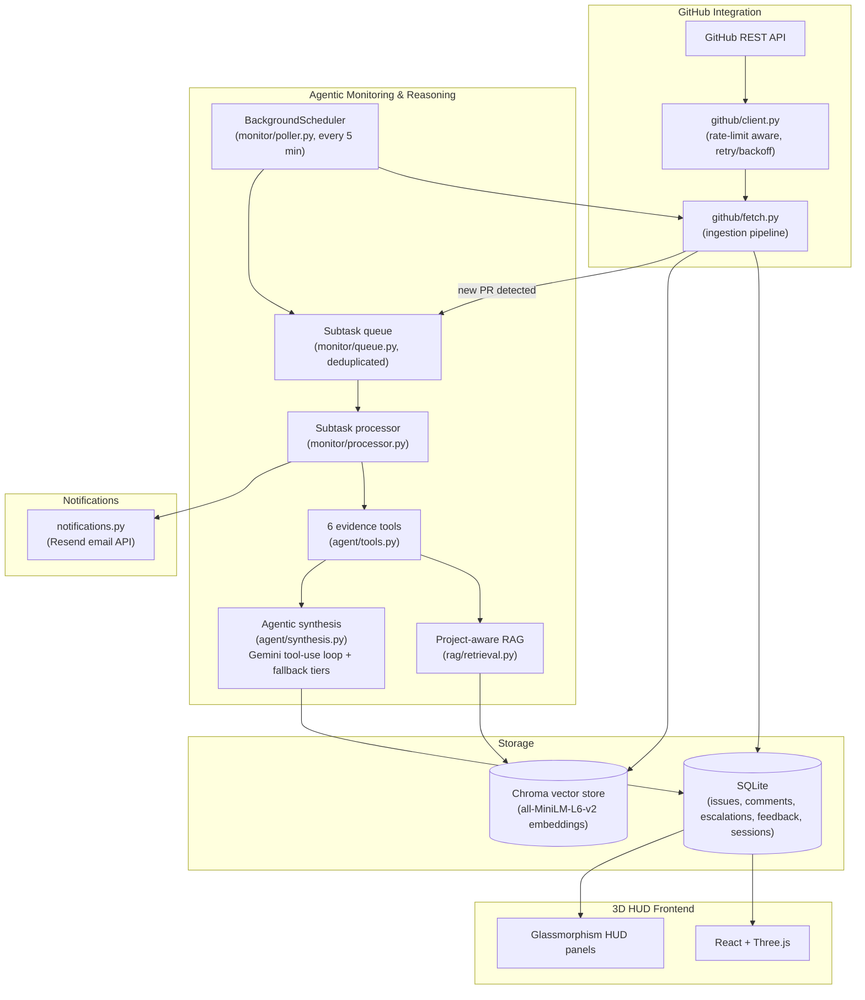
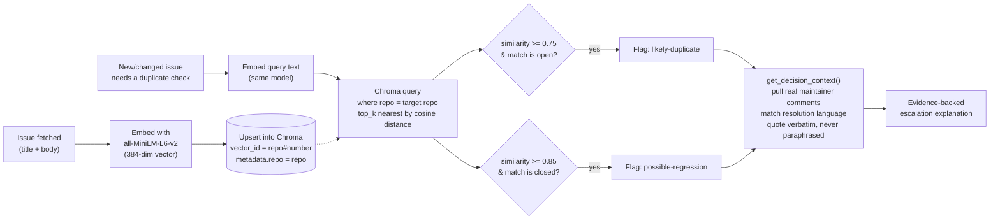
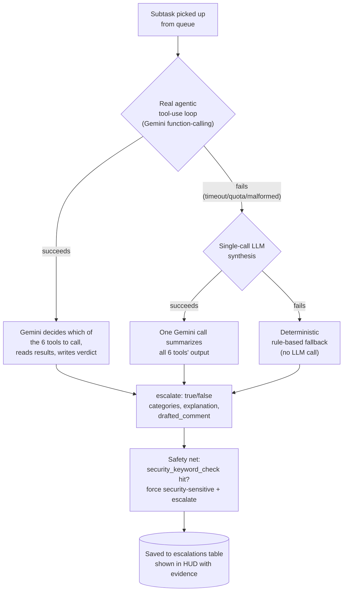

# RepoGuardian (PS-04)

**Autonomous GitHub issue & PR triage** — an agentic assistant that watches a
connected repository, gathers real evidence on every new or changed issue
from six independent tools, and **selectively escalates** only the issues
that actually need a maintainer's attention. Every escalation shows its
receipts: the real similarity score, the real quoted maintainer comment, the
real day count — never a bare "trust me" verdict.

Built for CODESTORM CODEISSANCE 2026, AI/ML track, PS-04 — *"RepoGuardian:
Agentic Open-Source Maintainer Assistant."*

## What it does

- **Continuously monitors** a connected repo (background poller, default
  every 5 minutes) for new and changed issues/PRs — no manual trigger needed.
- **Six independent evidence tools** per issue: duplicate/regression
  detection (semantic search), security-keyword scanning, response-time
  tracking, staleness detection, missing-info detection, and contentiousness
  detection.
- **A real agentic loop** — Gemini decides *which* of the six tools are
  worth calling for a given issue and in what order, instead of running all
  six reflexively on everything.
- **Project-aware RAG** — finds duplicate/regression issues via vector
  embeddings, not keyword matching, and cites the real maintainer comment
  that resolved a similar issue in the past (verbatim, never paraphrased).
- **Selective escalation** — most issues get zero flags. Only issues with
  real evidence behind them get raised, tagged with a category and a plain-
  English, evidence-cited explanation.
- **Human-in-the-loop feedback** — Confirm/Override on every escalation,
  with structured override reasons (`false_positive`, `wrong_category`,
  `not_a_duplicate`, `low_priority`) for future recalibration.
- **Email notifications** — a genuinely new PR on the connected repo
  triggers a real email to the signed-in maintainer.
- **GitHub-identity sign-in** — sign in with a GitHub Personal Access Token;
  that same token is the one used for read/write GitHub calls, so actions
  are tied to a real identity, not a shared app credential.
- **MCP server** (`backend/mcp/server.py`) — real JSON-RPC 2.0 / Model
  Context Protocol server exposing auth and repo-health tools.
- **Never hard-fails** — a three-tier fallback (real agentic tool-use →
  single-call LLM synthesis → deterministic rule engine) means an
  escalation always gets produced, even if the LLM API is rate-limited or
  down.
- **3D HUD dashboard** — React + Three.js frontend visualizing the repo's
  issue graph, health trends, and per-issue evidence.

See [`docs/ARCHITECTURE.md`](docs/ARCHITECTURE.md) for the deep-dive on the
RAG implementation (embedding model, calibrated thresholds, known
limitations) and [`docs/DEMO_SCRIPT.md`](docs/DEMO_SCRIPT.md) for the demo
walkthrough.

## Architecture



## RAG pipeline (duplicate & regression detection)



Thresholds (`0.75` / `0.85`) were calibrated by hand against 100 real issues
from a live open-source repo, not guessed — see
[`backend/scripts/test_rag.py`](backend/scripts/test_rag.py) for the
adversarial regression-test suite that verifies them, and
[`docs/ARCHITECTURE.md`](docs/ARCHITECTURE.md) for the full reasoning.

## Agentic decision pipeline (the "ML part")



The system never shows a bare error to a maintainer — if the real agentic
loop fails, it degrades gracefully through two more fallback tiers, always
producing a full evidence-backed verdict.

## Project structure

```
backend/
  app/
    main.py                 # FastAPI app assembly, route mounting, CORS
    config.py                # env loading, optional-at-boot config (ConfigError)
    notifications.py         # Resend email integration (PR notifications)
    llm.py                   # shared Gemini call helper
    repos.py                 # repo connect/switch orchestration
    brief.py                 # weekly brief generation

    api/                     # FastAPI routers
      auth.py                 # GitHub PAT/OAuth sign-in, session management
      issues.py                # GET /issues, GET /issues/{n}, comment/label/close
      feedback.py               # Confirm/Override + structured override reasons
      health.py                  # /health, /health-metrics
      health_trends.py            # historical health snapshots
      monitor.py                   # /monitor/status, /monitor/check-now

    agent/
      tools.py                 # the 6 evidence-gathering tools + calibrated thresholds
      synthesis.py               # agentic tool-use loop + 2-tier fallback
      tool_schemas.py              # Gemini function-calling schemas

    rag/
      embeddings.py             # sentence-transformers -> Chroma
      retrieval.py                # find_similar() + get_decision_context()

    github/
      client.py                 # GitHub REST client (rate-limit + backoff)
      fetch.py                    # fetch -> normalize -> store -> embed -> enqueue

    monitor/
      poller.py                 # BackgroundScheduler poll loop
      queue.py                    # subtask CRUD (dedupe_key)
      processor.py                 # drains queue, runs tools, sends notifications

    db/
      database.py                # SQLite connection, schema init/migration
      schema.sql                   # source-of-truth table definitions

  mcp/
    server.py                  # MCP (Model Context Protocol) JSON-RPC server

  scripts/
    test_rag.py                # adversarial regression suite for RAG thresholds
    seed_dummy_data.py           # offline demo data (zero keys needed)

frontend/
  src/
    App.jsx                    # app shell, auth/session state, data refresh
    api.js                       # backend client
    components/
      hud/                        # 3D HUD panels (IssueDetailPanel, MonitorPanel,
                                   #   ConnectRepoModal, RAGDiffModal, etc.)
      3d/                          # Three.js scenes (git graph, branch topology)
      auth/                        # 3D login page
    pages/                        # Dashboard, Duplicates, Security, Brief, Monitor

docs/
  ARCHITECTURE.md              # full RAG deep-dive: model, thresholds, limitations
  DEMO_SCRIPT.md                # live demo walkthrough
```

## Tech stack

- **Backend:** Python, FastAPI, SQLite (`sqlite3`, WAL mode, no ORM)
- **Vector store:** Chroma (local, persisted), cosine similarity, HNSW index
- **Embeddings:** `sentence-transformers` (`all-MiniLM-L6-v2`, local, no API key)
- **LLM:** Google Gemini (`google-generativeai`) — real agentic function-calling
- **Email:** Resend API
- **Auth:** GitHub Personal Access Token as session identity
- **Frontend:** React + Vite, Three.js / React-Three-Fiber, Tailwind, Recharts

## Running locally

**Backend:**
```bash
cd backend
python -m venv venv
venv\Scripts\activate        # Windows PowerShell: venv\Scripts\Activate.ps1
pip install -r requirements.txt
python scripts/init_db.py
uvicorn app.main:app --reload --port 8000
```

**Frontend:**
```bash
cd frontend
npm install
npm run dev
```

Open http://localhost:5173. You can sign in with **Demo Mode** (zero keys
needed) or a real GitHub PAT.

### Environment variables (`backend/.env`, see `.env.example`)

| Variable | Required? | Purpose |
|---|---|---|
| `GITHUB_TOKEN` / `TARGET_REPO` | Optional | Auto-connect a repo on startup |
| `GEMINI_API_KEY` | Optional | Real agentic synthesis (falls back to rule engine without it) |
| `RESEND_API_KEY` / `NOTIFY_FROM_EMAIL` | Optional | New-PR email notifications |
| `POLL_INTERVAL_SECONDS` | Optional (default `300`) | Background poll frequency |
| `CONNECT_SYNC_MAX_ITEMS` / `FULL_SYNC_MAX_ITEMS` | Optional | Sync batch sizes |

Every AI/GitHub-dependent feature is **optional at boot** — the app runs
with zero keys and degrades gracefully wherever a key is missing.
